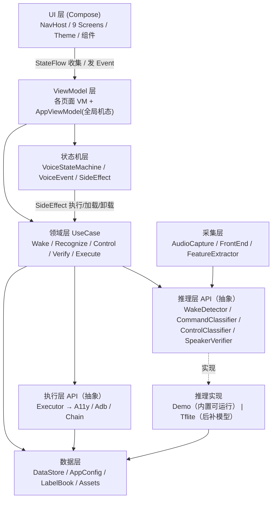

# 小胡语音控制 Android 架构方案（高见远 · 可直接落地版）

> 输入已逐字精读：`语音控制完整统一方案.html`（v2.2，§1/§7–§14）、`小胡语音控制-移动端原型.html`（15 导航项、states 表、COORDS/CMD_LIST）、`小胡语音控制-移动端视觉样式.css`（全部 token）。以下为完整方案原文。

---

## 0. 需求拆解（先对齐再开工）

**核心功能点**：①15 个页面/状态全实现；②可插拔推理层 + 内置 Demo 实现（真实 .tflite / owner.spk 后补，零改业务代码）；③GPU→NNAPI→CPU 自动降级 + 设置页手动切换 delegate；④C1 真退出（卸载模型、退出常驻拾音、仅手动恢复）；⑤执行层 A11y/内嵌 ADB 双实现；⑥CI 构建 APK。

**业务实体**：Wake/L1-L2、Command（ACTION×OBJECT 双头 14 类 + 拒识）、Control（C0–C4）、Speaker（192 维 embedding + 3 子质心模板）、CommandAction（tap/wait/verify 步骤序列）、Coordinate（基准 1080×2340）、AppConfig（§14 YAML 的运行时子集）。

**状态**：10 个机态（IDLE/LISTEN/VERIFY/CMD_WINDOW/EXECUTE/COOLDOWN/PAUSED/RECOG_OFF/MANUAL_SILENT/ERROR）+ UNLOAD_WAKE 过渡态；UI 侧映射为原型 7 态。

**硬约束**：C1 后 `MANUAL_SILENT` 必须真卸载 + StopCapture，只认手动事件；声纹是增强项不得成为单点故障（模板缺失自动降级非声纹）；自用不做多语言、不上 Hilt、不上市场。

---

## 1. 架构总览

### 1.1 分层与依赖方向（单向向下，接口倒置）


依赖铁律：**上层只依赖下层的抽象接口**；`Demo*` 与 `Tflite*` 实现平级、由 `AppContainer` 按 flavor+配置二选一注入；UI 绝不直接持有推理对象。

### 1.2 主数据流（唤醒→执行闭环）

```
AudioRecord(16k mono) → FrontEnd(AEC/NS/AGC/VAD) → FeatureExtractor(40 mel+CMVN)
  → WakeDetector.detectCoarse(τ.60) → detectFine(τ.90+3帧)
  → SpeakerVerifier.verify(τ_spk_wake .70) ─非本人→ 拒绝+埋点
  → EVENT_WAKE_OK → 状态机 CMD_WINDOW(3s) → ControlClassifier 优先(τ.85)
        ├─ C1 → UNLOAD_WAKE → 卸载模型+StopCapture → MANUAL_SILENT（仅手动恢复）
        ├─ C2 → RECOG_OFF（唤醒保留，唤醒后提示"识别已关闭"）
        ├─ C3 → PAUSED（30s 超时/语音/手动恢复）
        └─ C4 → LISTEN
  → CommandClassifier.classify(ACTION×OBJECT, τ.80) → SpeakerVerifier 复核(τ.65)
  → EVENT_COMMAND → EXECUTE → SideEffect(Execute) → ExecutorChain
        → [AccessibilityExecutor 主 → AdbInputExecutor 备] → ExecResult
  → EVENT_EXEC_DONE → COOLDOWN(1.5s) → IDLE
```
`ERROR`：连续 3 次异常→关语音并提示；任一态游戏离前台→EXIT（回 IDLE 并停采集）。

---

## 2. 模块与目录结构（精确到文件名）

自用单人开发，**采用单 app 模块 + 包分层**，不拆多 Gradle 模块（多模块只会拖慢本已只能靠 CI 验证的构建）。包名建议 `com.aixiaohu.voicectl`（与仓库名一致，可改）。

```
aixiaohu/
├── settings.gradle.kts                      # pluginManagement / versionCatalogs
├── build.gradle.kts                         # 根：plugins 声明 apply false
├── gradle/libs.versions.toml                # Version Catalog（唯一版本源）
├── gradle/wrapper/                          # ★必须入库：gradlew + gradle-wrapper.jar
├── .github/workflows/build-apk.yml          # ★CI（见 §8）
├── app/
│   ├── build.gradle.kts                     # flavor dev/gray/release + signing(debug)
│   ├── proguard-rules.pro
│   └── src/
│       ├── main/
│       │   ├── AndroidManifest.xml          # a11y service / foreground service / overlay
│       │   ├── java/com/aixiaohu/voicectl/
│       │   │   ├── App.kt                    # Application，持有 AppContainer
│       │   │   ├── di/AppContainer.kt        # 手工依赖容器（无 Hilt）
│       │   │   ├── config/
│       │   │   │   ├── AppConfig.kt          # §14 运行时配置数据类
│       │   │   │   ├── SettingsStore.kt      # Preferences DataStore 读写
│       │   │   │   └── LabelBook.kt          # §1 词表/标签映射（14 指令 + C0–C4）
│       │   │   ├── audio/
│       │   │   │   ├── AudioCapture.kt       # AudioRecord + 环形缓冲
│       │   │   │   ├── FrontEnd.kt           # AEC/NS/AGC/VAD
│       │   │   │   └── FeatureExtractor.kt   # 40 log-Mel + CMVN
│       │   │   ├── inference/                # ★可插拔推理层
│       │   │   │   ├── api/
│       │   │   │   │   ├── InferenceEngine.kt    # 基础契约 + Delegate 枚举 + EngineInfo
│       │   │   │   │   ├── WakeDetector.kt
│       │   │   │   │   ├── CommandClassifier.kt  # 含 CommandResult/ActionLabel/ObjectLabel
│       │   │   │   │   ├── ControlClassifier.kt  # 含 ControlResult/ControlWord
│       │   │   │   │   ├── SpeakerVerifier.kt    # 含 VerifyResult/SpeakerEnv
│       │   │   │   │   ├── InferenceFactory.kt   # 产出 4 个引擎的抽象工厂
│       │   │   │   │   └── DelegateChain.kt      # GPU→NNAPI→CPU 降级链
│       │   │   │   ├── demo/                 # ★内置可运行（默认）
│       │   │   │   │   ├── DemoInferenceFactory.kt
│       │   │   │   │   ├── DemoWakeDetector.kt
│       │   │   │   │   ├── DemoCommandClassifier.kt
│       │   │   │   │   ├── DemoControlClassifier.kt
│       │   │   │   │   └── DemoSpeakerVerifier.kt
│       │   │   │   └── tflite/               # ★真实实现（模型后补即生效）
│       │   │   │       ├── TfliteInferenceFactory.kt
│       │   │   │       ├── TfliteEngine.kt       # Interpreter 生命周期 + delegate
│       │   │   │       ├── TfliteWakeDetector.kt
│       │   │   │       ├── TfliteCommandClassifier.kt
│       │   │   │       ├── TfliteControlClassifier.kt
│       │   │   │       └── TfliteSpeakerVerifier.kt
│       │   │   ├── machine/
│       │   │   │   ├── VoiceStateMachine.kt  # §7 状态机 + SideEffect
│       │   │   │   └── ControlActionHandler.kt # C1–C4 副作用落地（真退出在这）
│       │   │   ├── domain/
│       │   │   │   ├── WakeUseCase.kt
│       │   │   │   ├── RecognizeUseCase.kt
│       │   │   │   ├── EnrollSpeakerUseCase.kt
│       │   │   │   └── ExecuteCommandUseCase.kt
│       │   │   ├── exec/
│       │   │   │   ├── Executor.kt           # 接口 + CommandAction/ExecResult(attempted)
│       │   │   │   ├── ExecutorChain.kt      # A11y→内嵌 ADB→只读提示；部分执行后禁止降级
│       │   │   │   ├── AccessibilityExecutor.kt
│       │   │   │   └── CoordinateMapper.kt   # x=x0*W/1080, y=y0*H/2340
│       │   │   ├── adb/                  # ★内嵌 ADB 客户端核心（无外部应用依赖）
│       │   │   │   ├── InputCommand.kt       # Tap / Swipe / KeyEvent + CommandResult
│       │   │   │   ├── CommandValidator.kt   # 坐标/时长/按键白名单强校验
│       │   │   │   ├── AdbStatus.kt          # 六态 + 真机环境快照 + 端点
│       │   │   │   ├── AdbClient.kt          # Kadb 配对/连接/shell + 私钥持久化
│       │   │   │   └── AdbInputExecutor.kt   # ExecStep → InputCommand
│       │   │   ├── service/
│       │   │   │   ├── VoiceForegroundService.kt   # 常驻通知 + 状态入口
│       │   │   │   ├── VoiceAccessibilityService.kt
│       │   │   │   └── FloatingBallService.kt     # 悬浮球（C1 后唯一恢复入口之一）
│       │   │   ├── ui/
│       │   │   │   ├── MainActivity.kt       # 单 Activity + setContent
│       │   │   │   ├── AppNavHost.kt         # 导航图（见 §6）
│       │   │   │   ├── theme/
│       │   │   │   │   ├── Color.kt          # CSS token → M3 ColorScheme + 7 态灯色
│       │   │   │   │   ├── Type.kt
│       │   │   │   │   ├── Shape.kt
│       │   │   │   │   └── Theme.kt
│       │   │   │   ├── common/               # StateCard / SectionCard / ToggleRow / Segment / ConfirmDialog
│       │   │   │   ├── onboarding/OnboardingScreen.kt
│       │   │   │   ├── permissions/PermissionsScreen.kt
│       │   │   │   ├── home/HomeScreen.kt + HomeViewModel.kt + StateCard.kt
│       │   │   │   ├── settings/SettingsScreen.kt + SettingsViewModel.kt
│       │   │   │   ├── voiceprint/VoiceprintScreen.kt + VoiceprintViewModel.kt
│       │   │   │   ├── panel/PanelScreen.kt + PanelViewModel.kt
│       │   │   │   ├── adb/AdbScreen.kt + AdbViewModel.kt
│       │   │   │   ├── mapping/MappingScreen.kt + MappingViewModel.kt
│       │   │   │   └── debug/DebugScreen.kt + DebugViewModel.kt
│       │   │   ├── monitor/Telemetry.kt      # 分模式埋点（脱敏）
│       │   │   └── util/Permissions.kt + Coroutines.kt
│       │   ├── res/values*/                  # strings(no 多语言)/themes.xml
│       │   └── assets/models/
│       │       ├── manifest.json             # 模型文件名/版本/输入输出张量规格
│       │       ├── labels.json               # §1 标签表
│       │       ├── wake_l1.tflite / wake_l2.tflite / cmd.tflite / spk.tflite  # 后补
│       │       └── owner.spk                 # 后补（加密模板）
│       ├── test/java/.../                    # JUnit4 + Turbine（状态机/坐标/ADB 命令边界）
│       └── androidTest/java/.../             # Compose 测试 + 关键流程仪器化
├── docs/                                    # 本方案 / 原型 / CSS / 内嵌 ADB 说明
└── README.md
```
**模型热切换机制**：`manifest.json` 声明模型是否齐全；`AppContainer` 启动时若检测 `*.tflite` 缺失或 manifest 标记 `demo=true` → 注入 `DemoInferenceFactory`；文件补齐后置 `demo=false` → 注入 `TfliteInferenceFactory`。**业务代码与 UI 零改动**。

---

## 3. 技术选型表（含理由与备选）

| 领域 | 选型 | 理由 | 备选/代价 |
|---|---|---|---|
| UI | Compose + Material 3 | 原原型是状态驱动，Compose 的重组天然契合 7 态切换；M3 主题可程序化映射 CSS token | XML 也可以但状态卡动画/波形手写成本高 |
| 导航 | Navigation Compose 2.8，单 Activity NavHost | 官方、支持 `home/{state}` 参数化（7 态共用一个 destination）、back stack 正确 | 手写 `when(destination)` 更轻但易丢返回栈 |
| 状态管理 | ViewModel + StateFlow（UI 状态）+ SharedFlow（一次性事件 Toast/跳转/确认弹窗） | 单向数据流、可测（Turbine）；机态用全局 `AppViewModel` 持有唯一状态机 | MVI 全量 reducer 对本场景偏重 |
| DI | 手工 `AppContainer`（Application 单例） | 自用单模块、无多 flavor 注入差异，免 KSP/Hilt 构建负担 | Hilt：可控性强但 CI 冷构建更慢、KSP 版本易踩坑 |
| 配置/存储 | Preferences DataStore（不用 Proto） | 只存开关/阈值/delegate 等标量；无代码生成 | Proto 强类型但需插件，自用不值 |
| 推理 delegate | `DelegateChain`：AUTO/GPU→NNAPI→CPU，逐档 try 创建 Interpreter，失败降级 | 用户明确要 GPU 直调；GpuDelegate 在部分荣耀机不兼容必须兜底 | 固定 CPU 最稳但放弃 NPU/GPU 性能 |
| 音频前端 | AudioRecord + AudioEffect(AEC/NS/AGC) + 能量 VAD | minSdk29 全覆盖，无需 AAudio 高版本特性 | AAudio 更低延迟但 API 门槛高 |
| 执行（主/备） | AccessibilityService → 内嵌 ADB 强类型 `input` 命令 → 只读提示；注入/Hook 禁止 | 与方案 §13.6/§16 既定优先级一致；应用内直接实现 ADB 客户端，不依赖外部应用，也不需要 PC | 命令动词由固定模板决定，参数均为校验后的整数，无任意字符串入口 |
| 可选链路隔离 | 内嵌 ADB 的配对/连接/shell 全在 IO 调度器执行，状态重算失败只记 telemetry | 备用链路不能拖垮 `Application.onCreate` 与语音主链 | 不隔离会在连接异常时阻塞 UI 线程 |
| 测试 | JUnit4 + Turbine + Compose Testing；仪器化测真机 delegate | 状态机/VM/命令边界纯 JVM 可测，UI 用 semantic matcher | — |
| 版本号 | AGP 8.5.2 / Kotlin 2.4.20 / Compose BOM 2024.09 / Kadb 1.3.0 / TFLite 2.16（libs.versions.toml 统一管理） | 需 JDK17 编译链；**版本以 CI 实际解析为准，CI 报错即调 toml** | 本机 JDK8 无法本地编译，CI 是唯一验证路径 |

---

## 4. 关键接口定义（Kotlin 签名）

### 4.1 推理层（Demo / TFLite 共用同一组接口）

```kotlin
// ---- 基础契约 ----
enum class Delegate { AUTO, GPU, NNAPI, CPU }

data class EngineInfo(
    val name: String,
    val version: String,
    val activeDelegate: Delegate,
    val supportedDelegates: List<Delegate>,
)

interface InferenceEngine {
    val info: EngineInfo
    val isLoaded: Boolean
    fun load(delegate: Delegate = Delegate.AUTO): Result<Unit>
    fun unload()                       // C1 真退出时由状态机副作用调用
}

// ---- 唤醒：L1 粗检 + L2 精检 ----
interface WakeDetector : InferenceEngine {
    fun detectCoarse(features: FloatArray): Float   // 比 τ_coarse(0.60)
    fun detectFine(features: FloatArray): Float     // 比 τ_fine(0.90) + 3 帧防抖
}

// ---- 指令：ACTION × OBJECT 双头（§1.3）----
enum class ActionLabel { A0_SWAP, A1_SWITCH, A2_NONE }
enum class ObjectLabel {
    E0_MINGDAO, E1_FUHUO, E2_HUIYUE, E3_XIXUE_SHU, E4_XIXUE_DAO,
    E5_BINGJIA, E6_XUEMO, P0..P5, P6_POSITION, OTHER
}
data class CommandResult(
    val action: ActionLabel, val obj: ObjectLabel,
    val commandId: Int,            // 0..14，14=CMD_OTHER_UNKNOWN
    val score: Float,
)
interface CommandClassifier : InferenceEngine {
    fun classify(features: FloatArray): CommandResult
}

// ---- 控制头 C0–C4（§1.6）----
enum class ControlWord { C0_NONE, C1_EXIT_WAKE, C2_EXIT_RECOG, C3_PAUSE, C4_RESUME }
data class ControlResult(val control: ControlWord, val score: Float)
interface ControlClassifier : InferenceEngine {
    fun classify(features: FloatArray): ControlResult   // 指令窗内先判，>τ_ctrl(0.85) 且≠C0
}

// ---- 声纹 1:1（§4.6）----
enum class SpeakerEnv { QUIET, GAME_LOUD, FAR_FIELD }
data class VerifyResult(val similarity: Float, val passed: Boolean)
interface SpeakerVerifier : InferenceEngine {
    fun hasTemplate(): Boolean
    fun enroll(embeddings: List<FloatArray>, env: SpeakerEnv): Result<Unit>
    fun verify(features: FloatArray, threshold: Float): VerifyResult
    fun deleteTemplate()               // 退回非声纹路径
    fun adapt(embedding: FloatArray, env: SpeakerEnv)  // EMA α=.05，连续拒绝3次冻结
}

// ---- 工厂 + delegate 降级链 ----
interface InferenceFactory {
    fun wakeDetector(): WakeDetector
    fun commandClassifier(): CommandClassifier
    fun controlClassifier(): ControlClassifier
    fun speakerVerifier(): SpeakerVerifier
}
class DelegateChain(private val preferred: Delegate) {
    fun candidates(): List<Delegate> = when (preferred) {
        Delegate.GPU, Delegate.AUTO   -> listOf(Delegate.GPU, Delegate.NNAPI, Delegate.CPU)
        Delegate.NNAPI                -> listOf(Delegate.NNAPI, Delegate.CPU)
        Delegate.CPU                  -> listOf(Delegate.CPU)
    }
}
```
实现要点：`DemoInferenceFactory` 各引擎 `load()` 恒成功、`activeDelegate` 回显设置值（用于设置页 UI 联调），`detect*/classify` 返回可配置的伪分数（默认低分，配合调试页/按钮演示状态流转）；`TfliteInferenceFactory` 由 `TfliteEngine` 按 `DelegateChain.candidates()` 逐个构造 `Interpreter.Options()`，捕获 `IllegalArgumentException/RuntimeException` 降级，最终把实际生效 delegate 写回 `EngineInfo`，供设置页显示"已降级到 CPU"。

### 4.2 状态机（覆盖 §7.2 全状态 + C1–C4）

```kotlin
enum class VoiceState {
    IDLE, LISTEN, VERIFY, CMD_WINDOW, EXECUTE, COOLDOWN,
    PAUSED, RECOG_OFF, MANUAL_SILENT, ERROR, UNLOAD_WAKE
}

sealed class VoiceEvent {
    data object Start : VoiceEvent()
    data object CoarseHit : VoiceEvent()                       // → VERIFY
    data object FineHit : VoiceEvent()
    data class WakeVerified(val sim: Float) : VoiceEvent()      // → CMD_WINDOW
    data object WakeRejected : VoiceEvent()                     // → LISTEN
    data object SilenceTimeout : VoiceEvent()                   // → COOLDOWN
    data class ControlDetected(val word: ControlWord, val sim: Float) : VoiceEvent()
    data object ExitConfirmed : VoiceEvent()                    // C1 二次确认后
    data class CommandDetected(val result: CommandResult, val sim: Float) : VoiceEvent()
    data object Rejected : VoiceEvent()
    data object ExecSucceeded : VoiceEvent()
    data object ExecFailed : VoiceEvent()
    data object CooldownElapsed : VoiceEvent()                  // → IDLE
    data object PauseTimeout : VoiceEvent()                     // → LISTEN
    data object ManualResume : VoiceEvent()                     // ★仅手动入口可发
    data object ExitGame : VoiceEvent()
    data class Error(val cause: Throwable) : VoiceEvent()
}

sealed class SideEffect {
    data object LoadModels : SideEffect()
    data object UnloadModels : SideEffect()                     // ★C1 真卸载
    data object StartCapture : SideEffect()
    data object StopCapture : SideEffect()                      // ★C1 后无常驻拾音
    data class Execute(val commandId: Int) : SideEffect()
    data class Feedback(val type: FeedbackType, val text: String) : SideEffect()
    data object RequestConfirmExit : SideEffect()               // C1 首次二次确认
    data class Telemetry(val dim: String, val name: String) : SideEffect()
}

class VoiceStateMachine(
    private val config: AppConfig,
) {
    val state: StateFlow<VoiceState>          // 当前机态
    val effects: SharedFlow<SideEffect>       // 副作用（VM/Service 订阅执行）
    fun send(event: VoiceEvent)
}
```
**迁移表（必须逐条实现并单测）**：
- `IDLE --Start--> LISTEN --CoarseHit--> VERIFY --FineHit+WakeVerified--> CMD_WINDOW`
- `VERIFY --WakeRejected--> LISTEN`；`CMD_WINDOW --SilenceTimeout--> COOLDOWN --CooldownElapsed--> IDLE`
- `CMD_WINDOW --ControlDetected(C1)--> [首次: emit RequestConfirmExit, 等 ExitConfirmed] → UNLOAD_WAKE --(emit UnloadModels+StopCapture)--> MANUAL_SILENT`
- `CMD_WINDOW --ControlDetected(C2)--> RECOG_OFF`（保留唤醒；`RECOG_OFF --WakeVerified--> CMD_WINDOW` 并提示识别关闭）
- `CMD_WINDOW --ControlDetected(C3)--> PAUSED`（30s `PauseTimeout` / C4 / 手动 → LISTEN）
- `CMD_WINDOW --ControlDetected(C4)--> LISTEN`
- `CMD_WINDOW --CommandDetected--> EXECUTE --ExecSucceeded/Failed--> COOLDOWN --> IDLE`
- `MANUAL_SILENT --ManualResume--> [emit LoadModels+StartCapture] --> LISTEN`
- **不变式**：`MANUAL_SILENT` 下除 `ManualResume / ExitGame` 外**忽略一切语音事件**；`ERROR` 连续 3 次→ `MANUAL_SILENT` + 提示。

### 4.3 执行层

```kotlin
interface Executor {
    val name: String
    fun isAvailable(): Boolean
    suspend fun execute(action: CommandAction): ExecResult
}
data class CommandAction(
    val commandId: Int,
    val steps: List<ExecStep>,        // tap(x,y) / wait(ms) / verify(key)
)
sealed class ExecStep {
    data class Tap(val x: Int, val y: Int) : ExecStep()
    data class Wait(val ms: Long) : ExecStep()
    data class Verify(val key: String) : ExecStep()   // 失败即停，retry ≤1
}
data class ExecResult(
    val success: Boolean, val message: String = "", val attempted: Boolean = false,
)

class AccessibilityExecutor(...) : Executor
class AdbInputExecutor(
    client: InputCommandExecutor, mapper: CoordinateMapper,
    screenSizeProvider: () -> Pair<Int, Int>,
) : Executor
class ExecutorChain(private val executors: List<Executor>) : Executor   // A11y → 内嵌 ADB → 只读提示
```
`InputCommandExecutor`：`suspend fun execute(command: InputCommand): CommandResult`；`AdbClient` 通过 Kadb 把强类型命令映射成固定 `input tap/swipe/keyevent` 模板，参数经 `CommandValidator` 校验，无字符串命令入口。`attempted=true` 的失败禁止降级重放，避免重复点击。

### 4.4 配置与词表（对应 §14 YAML / §1 标签）

```kotlin
data class AppConfig(
    val feature: FeatureConfig, val decode: DecodeConfig,
    val controlWords: ControlWordConfig, val voiceWakeup: WakeupConfig,
    val exec: ExecConfig, val speaker: SpeakerConfig,
    val preferredDelegate: Delegate, val useDemoModels: Boolean,
)
data class DecodeConfig(
    val tauCoarse: Float = .60f, val tauFine: Float = .90f, val debounceFrames: Int = 3,
    val cmdWindowS: Float = 3f, val tauCmd: Float = .80f, val tauCtrl: Float = .85f,
    val silenceTimeoutS: Float = 2f, val cooldownS: Float = 1.5f,
    val pauseDefaultS: Int = 30, val tauSpkWake: Float = .70f, val tauSpkCmd: Float = .65f,
)
data class WakeupConfig(
    val enabled: Boolean = true,
    val mode: WakeMode = WakeMode.VOICE,     // VOICE / MANUAL / MANUAL_SILENT
    val backupOnMiss: Boolean = true, val missPromptThreshold: Int = 3,
)
data class ControlWordConfig(
    val c1ConfirmOnFirst: Boolean = true, val c1UnloadWakeModel: Boolean = true,
    val c1Recovery: Recovery = Recovery.MANUAL_ONLY,
    val c2KeepWake: Boolean = true, val c3TimeoutS: Int = 30, val c4Enabled: Boolean = true,
)
data class SpeakerConfig(
    val enabled: Boolean = true, val minSamples: Int = 600,
    val gateMode: GateMode = GateMode.AND_HARD, val tempAllowOnReject: Int = 3,
    val fallbackToNonspk: Boolean = true,
)
data class ExecConfig(
    val primary: ExecKind = ExecKind.ACCESSIBILITY, val fallback: ExecKind = ExecKind.ADB,
    val coordBase: Size = Size(1080, 2340), val heartbeatS: Int = 5, val retryMax: Int = 1,
)
object LabelBook {
    val wakeLabels = listOf("WK_WAKE_NIHAO_XIAOHU","WK_WAKE_XIAOHU_XIAOHU",
        "WK_NEG_SILENCE","WK_NEG_GAME_AUDIO","WK_NEG_HUMAN_SPEECH","WK_NEG_HARD_NEAR")
    val commandLabels = mapOf(0 to "换名刀", 1 to "换复活甲", /* …2–13… */ 14 to "CMD_OTHER_UNKNOWN")
    val controlLabels = ControlWord.entries.associateWith { it.name }
}
```

---

## 5. 15 个页面清单与导航图

原型共 9 个 `screens`，其中 `home` 带 7 个 state → 侧栏恰为 15 个导航项。`NavHost` 用 8 个 destination + `home/{state}` 参数化承载 7 态。

| # | 导航目标 | Composable | 关键状态 | 跳转关系 |
|---|---|---|---|---|
| 1 | onboarding | `OnboardingScreen` | 合规提示、两个 CTA | → permissions；「暂不开启」→ home/manual_silent |
| 2 | permissions | `PermissionsScreen` | 麦克风/A11y/悬浮窗/通知 4 项 chip 态 | → home/idle（全允许）或 home/silent（仅手动） |
| 3 | home/idle | `HomeScreen` + `StateCard` | chip=VOICE「随时待命」；语音开关、模式、门控 4 项、最近指令 | → settings / panel / debug / 通知栏 shade / 退出确认框 |
| 4 | home/listening | 同上 | chip=LISTEN「正在聆听…」L1→L2→声纹 | 同上；由 VERIFY 事件驱动 |
| 5 | home/window | 同上 | chip=CMD 3s「请说指令」+3s 倒计时 | → execute / paused / recogoff / silent |
| 6 | home/executing | 同上 | chip=EXEC「换名刀」+冷却 1.5s，结果/撤销 | → idle（冷却结束） |
| 7 | home/paused | 同上 | chip=PAUSED「识别已暂停」+30s 倒计时、恢复按钮 | → listening（超时/C4/手动） |
| 8 | home/silent | 同上 | chip=SILENT「语音已退出」+「点悬浮球恢复」，徽标=无语音 | **仅**手动入口 → listening |
| 9 | home/recogoff | 同上 | chip=RECOG OFF「识别已关闭」唤醒仍在 | → window（唤醒后说 C4） |
| 10 | settings | `SettingsScreen` | 唤醒开关、voice/manual/silent 分段、灵敏度、反馈、退出二次确认、delegate 选择、声纹开关、四入口 | → voiceprint / mapping / adb / debug |
| 11 | voiceprint | `VoiceprintScreen` | 注册进度、三环境子质心、删除确认、临时放行；无模板时显示自测不可用 | → settings；删除弹窗 |
| 12 | panel | `PanelScreen` | 7 装备+6 号位+切换位置（14 项）、悬浮球交互说明 | 直选 → home/executing；→ home / settings / debug |
| 13 | adb | `AdbScreen` | 六态（NOT_READY/DISCONNECTED/PAIRED/CONNECTED/ERROR/UNSUPPORTED）+ 配对连接步骤 + 真机环境快照 + shell 自检 | → settings |
| 14 | mapping | `MappingScreen` | 3 tab：坐标库(公共6+槽位6+装备7)/指令编排/执行预览；基准 1080×2340 | → settings（返回） |
| 15 | debug | `DebugScreen` | 波形/频谱、L1/L2/cmd/ctrl/spk 真实快照、坐标拾取、事件日志；**仅 dev flavor** | → home / settings |

**导航图（route）**：`onboarding → permissions → home/{state}`；`home → settings → {voiceprint, mapping, adb(AdbScreen), debug}`；`home ⇄ panel`；`home → debug(dev)`。全局浮层：`ExitConfirmDialog`（C1）、`DeleteSpkDialog`、`NotificationShade`（前台服务通知）、`VoiceFab`（悬浮球，贯穿所有页面，C1 后唯一恢复入口）。`gray/release` flavor 隐藏 debug destination 与入口。

---

## 6. 视觉设计映射（CSS token → Material 3）

### 6.1 关键色值表（Color.kt）

| CSS token | 色值 | M3 ColorScheme 字段 / 用途 |
|---|---|---|
| `--brand` | `#0E7490` | `primary` |
| `--brand-strong` | `#0B5F73` | `primaryContainer` 文字 / 按压态 |
| `--brand-soft` | `#E6F4F6` | `primaryContainer` |
| `--brand-tint` | `#F1F9FA` | hover/tint 背景 |
| `--on-brand` | `#FFFFFF` | `onPrimary` |
| `--bg` | `#F6F7F9` | `background` |
| `--surface` | `#FFFFFF` | `surface` |
| `--surface-2` | `#F9FAFC` | `surfaceVariant` |
| `--ink` | `#1F2733` | `onBackground` / `onSurface` |
| `--ink-2` / `--muted` | `#4A5568` / `#5B6879` | `onSurfaceVariant` |
| `--line` / `--line-strong` | `#E3E8EF` / `#D3DBE6` | `outline` / `outlineVariant` |
| `--ok` / `--ok-bg` / `--ok-bd` | `#1B6E34` / `#EAF6EE` / `#BFE3CB` | 成功 chip/tag |
| `--warn` / `--warn-bg` / `--warn-bd` | `#8A5A00` / `#FFF7E8` / `#F3DCA8` | 警告 / `--warn`≈`secondary` |
| `--danger` / `--danger-bg` / `--danger-bd` | `#A03A3A` / `#FDEDED` / `#F3C7C7` | `error` / `errorContainer` |
| `--info` / `--info-bg` | `#1C4B8C` / `#EEF5FF` | 调试页信息条 |
| `--panel` / `--panel-2` | `#121A2A` / `#1A2536` | **深色状态卡/引导 hero/通知 shade 背景** |
| `--panel-line` | `rgba(255,255,255,.10)` | 状态卡描边 |
| `--panel-ink` / `--panel-muted` / `--panel-faint` | `#E6EDF5` / `#A9B8CA` / `#7C90A8` | 深色卡文字三级 |

### 6.2 深色状态面板（7 态共用一张卡，`StateCard.kt`）

卡背景 `--panel`、顶部 3px `--state-accent` 条、圆形 orb 呼吸/脉冲动画、7 根波形条；M3 无对应槽位 → 定义 `data class StateCardColors(accent, background, onBackground, muted, line)` 由 `CompositionLocalProvider` 提供，7 态切 `accent`。

### 6.3 七种状态灯颜色（与原型 `states` 表/CSS `--st-*` 一一对应）

| UI 态 | CSS 变量 | 色值 | 机态映射 |
|---|---|---|---|
| idle | `--st-idle` | `#A9B8CA` | IDLE |
| listening | `--st-listening` | `#22D3EE` | LISTEN + VERIFY |
| window | `--st-window` | `#5EEAD4` | CMD_WINDOW |
| executing | `--st-executing` | `#34D399` | EXECUTE + COOLDOWN |
| paused | `--st-paused` | `#FBBF24` | PAUSED |
| recogoff | `--st-recogoff` | `#7C90A8` | RECOG_OFF |
| silent | `--st-silent` | `#94A3B8` | MANUAL_SILENT（ERROR 复用 + error 提示） |

### 6.4 字体与形状

`Typography`：`display=24px(fs-display)→headlineMedium`、`title=18px→titleMedium`、`body=15px→bodyMedium`、`sub=13px→bodySmall/labelLarge`、`caption=11px→labelSmall`；行高 body 1.65 / tight 1.3；字重 400/600/700。`Shapes`：`r-xs 6 / r-sm 9 / r-md 12 / r-lg 16 / pill 999（自定义）`。动效：`dur=160ms ease(cubic-bezier(.2,.7,.3,1))`，用 `animateDpAsState/tween(160)`；遵循 `prefers-reduced-motion`（`isReduceMotionEnabled` 时关波形/呼吸动画）。

---

## 7. GitHub Actions 工作流设计（`.github/workflows/build-apk.yml`）

- **触发**：`on: [push, workflow_dispatch]`（所有分支 push 都构建，便于 android-coder 每次提交验证；可后续加 `paths-ignore: docs/**`）。
- **环境**：`ubuntu-latest` + `actions/setup-java@v4`（`temurin`, **JDK 17** — Compose/AGP8 必需，本机 JDK8 不参与构建）+ `android-actions/setup-android@v3`，随后 `sdkmanager "platforms;android-34" "build-tools;34.0.0" "platform-tools"`。
- **构建**：`chmod +x ./gradlew && ./gradlew --no-daemon assembleDevDebug`（dev flavor 出可安装调试包；签名用 debug keystore）。
- **产物**：`app/build/outputs/apk/dev/debug/app-dev-debug.apk`，`actions/upload-artifact@v4` 上传（`name: aixiaohu-dev-debug`, `retention-days: 14`）。
- **加速**：`actions/setup-gradle@v4`（依赖缓存）。
- **前置硬性要求**：`gradle/wrapper/`（gradlew + jar + properties）必须入库——本机 JDK8 生成不了 wrapper，请 android-coder 从标准模板复制后提交；`gradle-wrapper.properties` 的 Gradle 版本需与 AGP 兼容（建议 8.7+）。

```yaml
name: build-apk
on: [push, workflow_dispatch]
jobs:
  build:
    runs-on: ubuntu-latest
    steps:
      - uses: actions/checkout@v4
      - uses: actions/setup-java@v4
        with: { distribution: temurin, java-version: '17' }
      - uses: android-actions/setup-android@v3
      - run: sdkmanager "platforms;android-34" "build-tools;34.0.0" "platform-tools"
      - uses: actions/setup-gradle@v4
      - run: chmod +x ./gradlew && ./gradlew --no-daemon assembleDevDebug
      - uses: actions/upload-artifact@v4
        with: { name: aixiaohu-dev-debug, path: app/build/outputs/apk/dev/debug/*.apk, retention-days: 14 }
```

---

## 8. 实现步骤清单（按依赖顺序，供 android-coder 逐项落地）

> 关键节奏：**先让 CI 跑通空壳 APK，再逐层加代码**。本机无法编译，任何一步都以「push 后 artifact 产出且编译通过」为完成判据。

1. **仓库与 CI 骨架**：Gradle KTS 根工程 + `libs.versions.toml` + gradle wrapper + `app` 空壳 + flavor dev/gray/release + `build-apk.yml`。完成判据：push 后 artifact 有可安装 APK。（最高优先级）
2. **配置与数据底座**：`AppConfig`/`DecodeConfig` 等数据类、`SettingsStore`（DataStore）、`LabelBook`、`manifest.json`/`labels.json` 模板；`AppContainer` 手工容器。
3. **主题层**：`Color.kt`/`Type.kt`/`Shape.kt`/`Theme.kt` + `StateCardColors` + 7 态灯色 + CompositionLocal。
4. **推理 API + Demo 实现**（可运行优先）：`inference/api/*` 全部接口 + `DelegateChain`；`demo/*` 五文件；`AppContainer` 默认注入 Demo（此时 App 即可全流程点按钮演示 7 态）。
5. **状态机 + 单测**：`VoiceStateMachine` 全迁移表（重点 C1 真退出、C2/C3/C4、ERROR 连续 3 次）；`ControlActionHandler` 落地 Unload/StopCapture；JUnit+Turbine 覆盖每条迁移。
6. **导航与全局壳**：`MainActivity` + `AppNavHost`（8 destination + home/{state}）+ `AppViewModel`（持状态机、订阅 SideEffect）+ 全局浮层（C1 确认/删除声纹/通知 shade/悬浮球）。
7. **主页 7 态 UI**：`HomeScreen` + `StateCard` + 状态卡动画 + 门控 4 项 + 最近指令列表 + 快捷按钮；与状态机 StateFlow 打通（原型的 `playFlow` 流程可做成 debug 页的演示按钮）。
8. **引导 + 权限页**：`OnboardingScreen`/`PermissionsScreen`，权限按需申请、拒绝降级到 manual/silent。
9. **设置页**：`SettingsScreen`（唤醒开关/模式分段/灵敏度/反馈/退出二次确认/**delegate 手动切换**/声纹入口/内嵌 ADB/映射/调试入口/版本号）；delegate 切换写 DataStore 并重载引擎、显示实际生效 delegate。
10. **声纹页**：`VoiceprintScreen` 注册进度/三环境子质心/删除确认/临时放行；无模板时明确提示自测不可用，不展示伪造接受率。
11. **手动面板页**：`PanelScreen` 14 项 cmd-grid（7 装备+6 号位+切换位置）+ 悬浮球交互说明；点击走 `ExecutorChain` → home/executing。
12. **内嵌 ADB 页 + 执行层**：`AdbScreen` + `AdbViewModel` + `AdbClient`/`AdbInputExecutor`/`InputCommand`/`CommandValidator`/`CoordinateMapper`/`AccessibilityExecutor`/`ExecutorChain`；Android 11+ 无线调试配对/连接步骤引导，六态与真机环境快照全部来自真实探测。原型 COORDS 表落到 `docs` 常量，真实坐标需真机实测。
13. **指令映射页**：`MappingScreen` 三 tab（坐标库/指令编排/执行预览）；COORDS(6+6+7) 与 CMD_LIST 步骤序列落数据模型，支持编辑与基准换算。
14. **调试页（dev flavor）**：`DebugScreen` 波形/置信度条/坐标拾取/事件日志；sourceSet 隔离 `src/dev` 提供入口，`gray/release` 不编译该页。
15. **TFLite 实现骨架**：`tflite/*` 五文件 + `TfliteEngine` 的 delegate 降级链 + 从 `assets/models/manifest.json` 读张量规格；模型缺失时 `load()` 返回明确错误，`AppContainer` 自动回落 Demo。**注意：不写真实推理算法，只写加载/映射/降级框架**；待用户提供 .tflite/owner.spk 后填 assets 即切换。
16. **端到端联调**：C1 真退出逐条验证（卸载后 Debug 页应看不到推理活动、麦克风释放）；C2/C3/C4、声纹拒绝/降级、delegate 降级、内嵌 ADB 配对失效与连接断开重连；埋点 `Telemetry` 分模式维度。
17. **测试与交付**：补 JVM 单测 + Compose 测试；最终 push 产 artifact，附 README（构建命令/安装/模型替换说明/自用免责声明）。

---

## 9. 待确认项（不阻塞开工，但需在对应步骤前定）

1. 真实模型文件名、输入输出张量名/形状/dtype → 填 `manifest.json`（用户提供后仅需改 assets，不动代码）。
2. `owner.spk` 加密格式（建议：自定义头 + AES，密钥不入仓；与 TfliteSpeakerVerifier 约定）。
3. 目标设备无线调试配对端口/连接端口与 TLS 1.3 支持情况 → 决定页面六态与 shell 自检结果；不支持时明确显示，不做假数值。
4. 包名最终确认：本文暂用 `com.aixiaohu.voicectl`。
5. delegate 版本兼容：GpuDelegate 在部分荣耀机型的 NNAPI 差异只能靠真机/CI 验证；若 CI 无真机，delegate 实际降级表现需用户在真机调试页确认。

---

**给 android-coder 的三条红线提醒**：①每一步以 CI artifact 编译通过为准，别在本机 JDK8 上折腾构建；②禁写任何注入/Hook/读内存代码，执行只走 A11y/内嵌 ADB（强类型命令 → `input tap/swipe/keyevent`）/只读提示；③C1 必须是真卸载 + StopCapture，且 `MANUAL_SILENT` 只认手动事件，禁止"隐藏 UI 后台仍听"的假退出。
